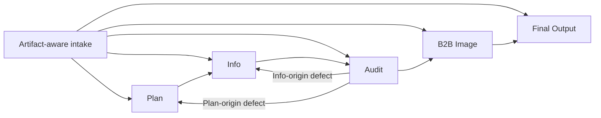

# Architecture

The intake edges represent valid stage insertion, not permission to skip gates. A supplied article enters Audit; it can continue only after Audit passes. Every rollback replays affected downstream stages.

